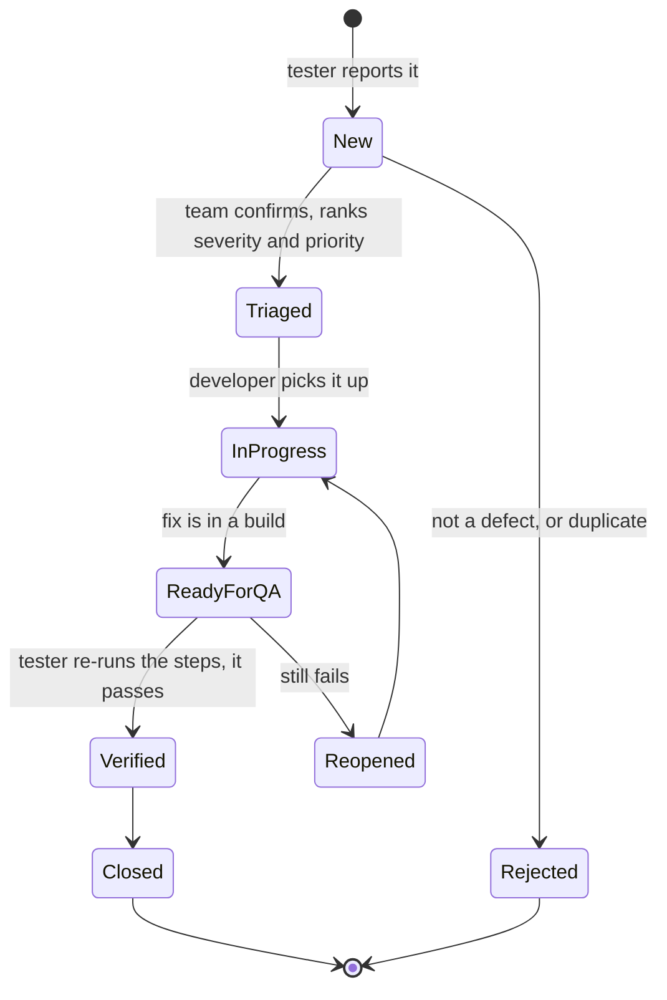

# Defect workflow and Jira import

How a defect is written, ranked and moved from "found" to "closed", and how the 20 defects of this project load into Jira.

## 1. What a good defect report contains
Every report in [defects/](../defects/) has the same fields, so a developer can act without asking questions.

| Field | Rule |
|---|---|
| Title | One line: what is wrong and where. "Login can be bypassed by forging an unsigned session cookie", not "Login broken" |
| Environment | Site, browser, test user and date |
| Steps to reproduce | Numbered, starting from a clean state, so someone else gets the same result |
| Expected result | What should happen, and why (the requirement or the standard) |
| Actual result | What did happen, with exact text, values and numbers |
| Evidence | A screenshot or recording, named in the report |
| Severity and priority | Ranked as in section 2 |
| Linked test cases | Which cases failed because of it |

## 2. Severity and priority are different questions
- **Severity** is how bad the problem is for the product: *Critical* (security, data loss, nothing works), *Major* (an important feature is wrong), *Minor* (a nuisance or cosmetic).
- **Priority** is how soon it should be fixed, which also depends on the business: a Minor typo on the home page of a launch can be High priority; a Major bug in a feature nobody uses can wait.

Mapping used when importing into Jira: Critical priority becomes *Highest*, then High, Medium and Low unchanged.

## 3. Life of a defect

Rules that keep the list trustworthy: only the tester closes a defect, after repeating the original steps; a reopened defect gets a comment saying what still fails; a defect that cannot be reproduced is returned with a request for more detail, not deleted.

## 4. Importing into Jira
[defects/jira-import.csv](../defects/jira-import.csv) is generated from the same data as the reports, so it cannot disagree with them. In Jira: *Settings, System, External System Import, CSV*, choose the file, then map the columns:

| CSV column | Jira field |
|---|---|
| Summary | Summary |
| Issue Type | Issue Type (Bug) |
| Priority | Priority |
| Labels | Labels (space separated) |
| Component | Component/s |
| Environment | Environment |
| Description | Description (written in Jira's wiki markup: numbered steps, bold headings) |

Screenshots are attached afterwards from the [evidence](../evidence/) folder; a CSV import cannot upload files.

The file is built to Jira's CSV import format, but it has not been imported into a live Jira instance in this project, so check the field mapping on the import screen the first time.
